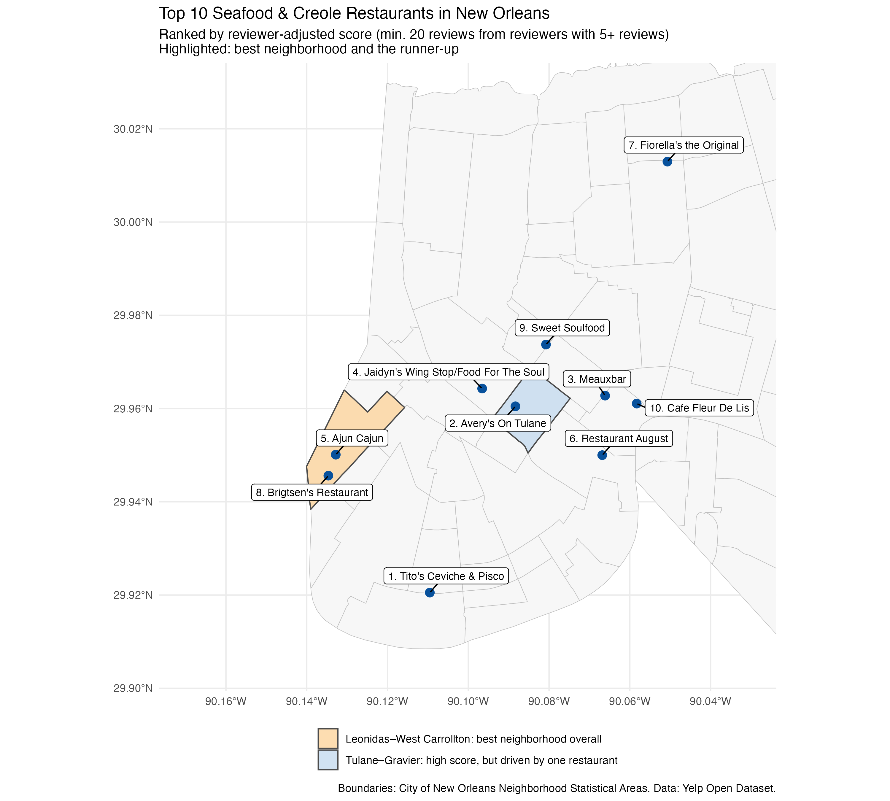

# Where to Find the Best Seafood & Creole Food in New Orleans

[**📄 View the complete report**](https://vincentheqi.github.io/yelp-new-orleans-project/): a rendered HTML report with all tables, maps, and code (no setup needed).

## Research question

> Where can someone find the best seafood, Cajun/Creole, Southern, and soul food restaurants in New Orleans, and which neighborhood is best for finding them?

## Executive summary

I analyzed 658 seafood, Cajun/Creole, Southern, and soul food restaurants inside the official New Orleans city boundary, using all 249,146 of their Yelp reviews. Instead of relying on raw star averages, I adjusted each rating for the reviewer's personal scoring habits, so a restaurant scores well only when experienced reviewers rate it **above their own usual rating**. The best neighborhood for finding a great meal is **Leonidas–West Carrollton**; the French Quarter has the most options but the lowest odds of picking a standout.

## Main findings

1.  **Best neighborhood: Leonidas–West Carrollton.** About 2 in 3 of its well-reviewed restaurants beat their reviewers' usual rating. It ranked in the top two at every reviewer threshold I tested, and its score did not depend on any single restaurant.
2.  **The French Quarter has the most choice but the lowest hit rate.** It holds a quarter of these restaurants and about 98,000 reviews, but only about 1 in 3 of its well-reviewed restaurants beat their reviewers' norm.
3.  **Raw stars can mislead.** Some restaurants with high averages drop sharply once one-time reviewers are set aside, and others with modest averages rise. The neighborhood with the highest adjusted score (Tulane–Gravier) turned out to depend on one restaurant.



### Top 10 restaurants (reviewer-adjusted)

| Rank | Restaurant | Neighborhood | Avg. stars (all reviewers) | Adjusted score |
|---:|----|----|---:|---:|
| 1 | Tito's Ceviche & Pisco | Uptown | 4.72 | +0.59 |
| 2 | Avery's On Tulane | Tulane–Gravier | 4.64 | +0.59 |
| 3 | Meauxbar | Vieux Carré (French Quarter) | 4.40 | +0.58 |
| 4 | Jaidyn's Wing Stop/Food For The Soul | Mid-City | 4.58 | +0.58 |
| 5 | Ajun Cajun | Leonidas–West Carrollton | 4.63 | +0.54 |
| 6 | Restaurant August | Central Business District | 4.45 | +0.52 |
| 7 | Fiorella's the Original | Gentilly Terrace | 4.44 | +0.52 |
| 8 | Brigtsen's Restaurant | Leonidas–West Carrollton | 4.54 | +0.51 |
| 9 | Sweet Soulfood | Bayou St. John | 4.72 | +0.49 |
| 10 | Cafe Fleur De Lis | Vieux Carré (French Quarter) | 4.10 | +0.49 |

*Adjusted score = average of (stars given − that reviewer's usual rating), from reviewers with 5+ reviews in this group; only restaurants with 20+ such reviews are ranked. The exact order is sensitive to the reviewer threshold, so read this as a list of strong candidates.*

## Methods in brief

- **Large data:** streamed the 5.3 GB Yelp review file in 50,000-line chunks, keeping only New Orleans restaurant reviews. Memory stayed under \~1.3 GB with no sampling.
- **Categories:** seafood, cajun/creole, southern, and soul food, chosen using category co-occurrence counts (a restaurant qualifies with at least one).
- **Geography:** joined restaurants to the official Census city boundary, then compared ZIP codes, Census tracts, and **Neighborhood Statistical Areas**, choosing the last for the main analysis.
- **Ratings:** compared ordinary averages from all reviewers with reviewer-adjusted scores, then checked robustness (reviewer thresholds 3/5/10, leave-one-restaurant-out, ZIP-code comparison).

Full details, tables, and limitations are in the [**report**](https://vincentheqi.github.io/yelp-new-orleans-project/).

## Repository contents

``` text
yelp-new-orleans-project/
├── README.md                      # this page
├── yelp_new_orleans_project.qmd   # Quarto source of the report
├── docs/index.html                # rendered report (published with GitHub Pages)
├── R/
│   ├── import.R                   # stream raw JSON, filter to New Orleans restaurants
│   ├── categories.R               # category counts, co-occurrence, review join
│   ├── geography.R                # city-boundary join, ZCTA/tract/NSA comparison, maps
│   └── ratings.R                  # reviewer adjustment, rankings, robustness checks, final map
├── data/
│   ├── raw/                       # Yelp JSON files (NOT committed, see below)
│   └── new_orleans/               # small filtered .rds files used by the report
├── figures/                       # maps, plots, and summary tables
├── geography_choice.md            # Steps 3–6 checkpoint write-up
└── ai-log.md                      # AI prompts and re-prompting examples
```

## Source code

- [Data import](R/import.R)
- [Categories and review join](R/categories.R)
- [Spatial joins and geographic comparison](R/geography.R)
- [Reviewer-adjusted ratings and final map](R/ratings.R)
- [Quarto report source](yelp_new_orleans_project.qmd)
- [AI prompt log](ai-log.md)

## Reproducing the analysis

**The raw data is not in this repository.** The Yelp JSON files are over 5 GB, far beyond GitHub's 100 MB file limit, and Yelp's terms govern their redistribution. They are listed in `.gitignore`.

1.  Download the JSON dataset from the [Yelp Open Dataset page](https://business.yelp.com/data/resources/open-dataset/) and extract it.
2.  Place `yelp_academic_dataset_business.json` and `yelp_academic_dataset_review.json` in `data/raw/`.
3.  Install packages: `install.packages(c("tidyverse", "jsonlite", "sf", "tigris", "ggrepel", "knitr"))`
4.  Run the scripts in order: `R/import.R` → `R/categories.R` → `R/geography.R` → `R/ratings.R`. `geography.R` needs internet access to download Census and City of New Orleans boundaries.
5.  Render the report: `quarto render yelp_new_orleans_project.qmd --output-dir docs`

To re-render the report only, steps 1–4 are not needed: the report reads the committed files in `data/new_orleans/` and `figures/`.

Built with R 4.6.1 and Quarto.

## Data sources

- Yelp Open Dataset: <https://business.yelp.com/data/resources/open-dataset/>
- U.S. Census TIGER/Line boundaries via [`tigris`](https://walker-data.com/tigris/)
- City of New Orleans Neighborhood Statistical Areas: [City GIS server](https://gis.nola.gov/arcgis/rest/services/apps/BoundariesMayorysViewer/MapServer/3)

------------------------------------------------------------------------

*Zhanxiang (Vincent) He · MATH 167R, San José State University*
