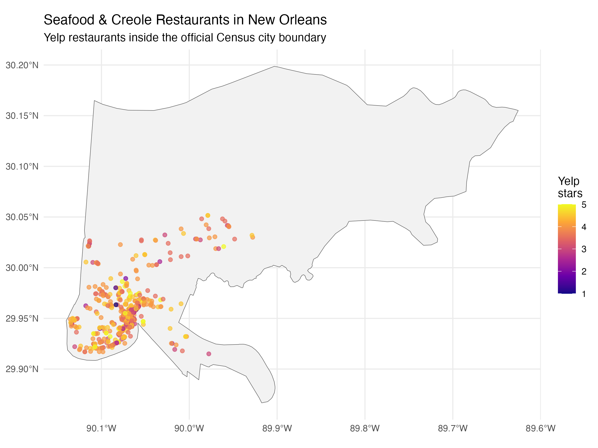
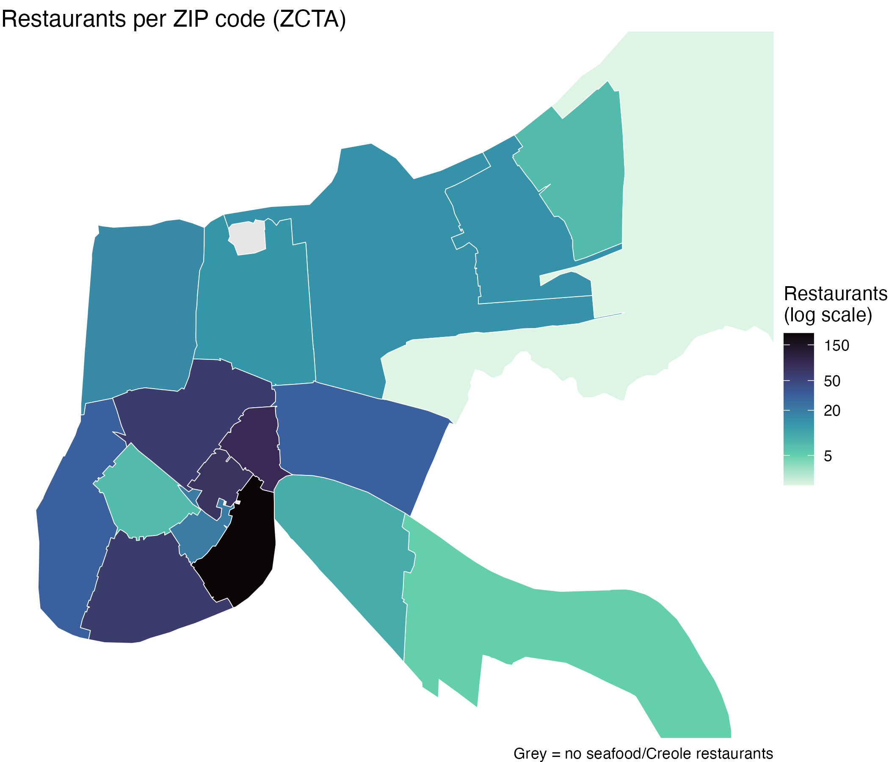
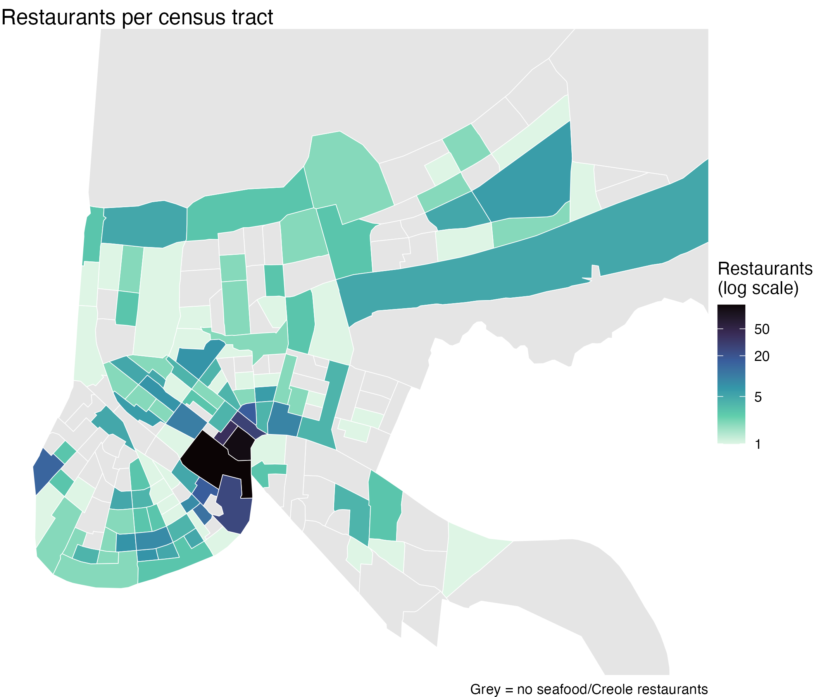
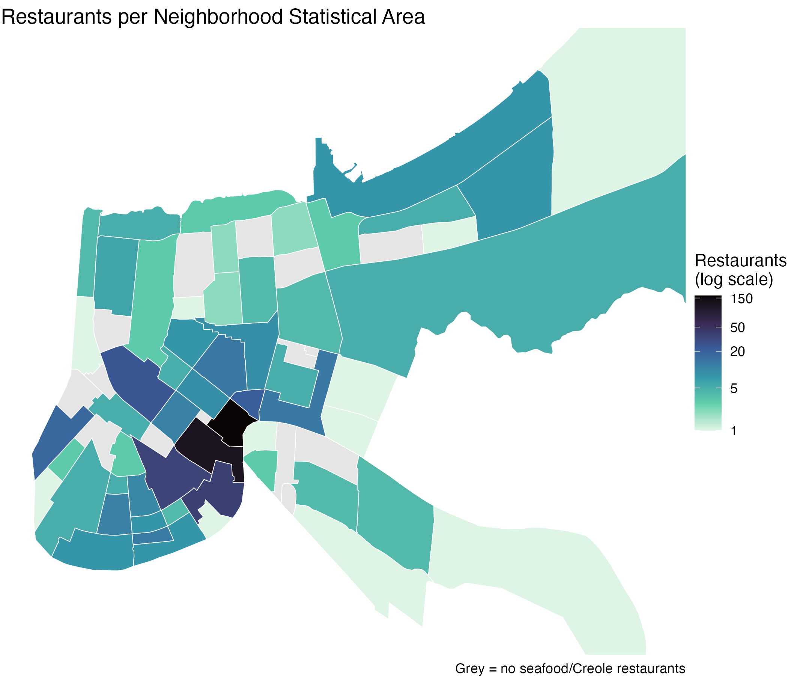

# Choosing a Geographic Area (Steps 3–6)

**Project:** Where can someone find the best seafood and Creole restaurants in New Orleans, and which neighborhood is best for finding them?

**Selected geography: Neighborhood Statistical Areas (NSAs)**, with ZIP codes (ZCTAs) kept as a robustness check.

Code: [`R/categories.R`](R/categories.R) (Steps 3–4) and [`R/geography.R`](R/geography.R) (Steps 5–6).

------------------------------------------------------------------------

## Step 3: Selected restaurant categories

I chose four related categories: **seafood, cajun/creole, southern, and soul food**. A restaurant is included if it has **at least one** of these categories. That gives **674 New Orleans restaurants**.

These categories describe one overlapping Gulf Coast and Southern food tradition, not four separate cuisines. The co-occurrence counts support that:

| Category pair            | Restaurants with both |
|--------------------------|----------------------:|
| cajun/creole + seafood   |                   156 |
| cajun/creole + southern  |                    72 |
| seafood + southern       |                    45 |
| cajun/creole + soul food |                    30 |
| seafood + soul food      |                    20 |
| soul food + southern     |                    19 |

All six possible pairs occur, and cajun/creole connects the other three. It is also the most common partner category of seafood, and seafood is the most common partner of cajun/creole. Nightlife and bars also co-occur often, but they describe the type of venue, not the food, so I left them out.

## Step 4: Join to reviews

The reviews were filtered to these restaurants before joining on `business_id`, which is a one-to-many join. The result is **250,448 reviews for all 674 restaurants**. These restaurants are 30% of New Orleans restaurants but receive 53% of all New Orleans restaurant reviews.

## Step 5: Spatial join to the official city boundary

I joined every Yelp restaurant labeled "New Orleans" (2,261) to the 2024 Census place boundaries with `st_within`.

| Result                                             |   Restaurants |
|----------------------------------------------------|--------------:|
| Inside the official New Orleans boundary           | 2,204 (97.5%) |
| Labeled "New Orleans" but located in another place |     57 (2.5%) |

The 57 mismatches are not geocoding errors. Most are in Jefferson Parish suburbs, mainly Elmwood (ZIP 70121/70123), Jefferson and Harahan. The Postal Service uses "New Orleans" as the mailing city for parts of those suburbs. Because the question is about restaurants *in* New Orleans, I kept only restaurants inside the official boundary: **658 of the 674 selected restaurants**.

Note: Census boundaries come in NAD83 (EPSG 4269), while the Yelp points use WGS84 (EPSG 4326). The boundaries were transformed with `st_transform(4326)` before the join.

## Step 6: Comparing geographic systems

I tested three systems with the same spatial-join function:

| Geographic system | Number of areas | Areas with restaurants | Restaurants assigned | Unmatched | Smallest area count | Largest area count | Median per area | Areas with 5 or more |
|----|---:|---:|---:|---:|---:|---:|---:|---:|
| ZIP/ZCTA | 20 | 17 | 658 | 0 | 2 | 214 | 16 | 16 |
| Census tract | 184 | 111 | 658 | 0 | 1 | 113 | 2 | 29 |
| Neighborhood Statistical Area | 72 | 56 | 658 | 0 | 1 | 164 | 5 | 30 |

Every restaurant matched exactly one area in all three systems: no unmatched points and no double matches.

| ZIP code (ZCTA) | Census tract | Neighborhood Statistical Area |
|----|----|----|
|  |  |  |

### Why Neighborhood Statistical Areas

- **They match the question.** Someone looking for seafood thinks in neighborhoods, like the French Quarter, Marigny or Bywater, not ZIP codes or census tract numbers. NSAs are the City of New Orleans' official neighborhood boundaries, and they have documented names.
- **Enough restaurants to compare.** NSAs give the most areas with at least 5 restaurants (30), and the selected group easily passes the requirement of 10+ restaurants in 7+ areas (658 restaurants in 56 neighborhoods).
- **Census tracts are too small.** 73 of the 184 tracts have no restaurants in this group, and the median tract has only 2, too few for a stable average rating.
- **ZIP codes are too coarse.** ZCTAs are stable, with a median of 16 restaurants each, but one ZIP holds 214 restaurants, about a third of the data. ZCTAs are also postal approximations, not neighborhoods, so they would hide differences between areas like the French Quarter and Marigny. I will keep ZCTAs as a robustness check.
- **Clean joins.** There are 0 unmatched restaurants, and the boundaries load directly from the City's GIS server.

**Safeguard:** many NSAs have only 1–4 restaurants. When ranking neighborhoods, I will only rank NSAs with **at least 5 restaurants** (30 neighborhoods), so one or two restaurants cannot decide a neighborhood's result.

### First look: top neighborhoods by number of restaurants

| Neighborhood (NSA) | Restaurants | Average business stars | Median stars | Total reviews |
|----|---:|---:|---:|---:|
| Vieux Carré (French Quarter) | 164 | 3.68 | 4.0 | 97,727 |
| Central Business District | 117 | 3.71 | 3.5 | 59,995 |
| St. Thomas Area – Lower Garden District | 38 | 3.79 | 4.0 | 14,864 |
| Central City – Magnolia | 35 | 3.93 | 4.0 | 7,509 |
| Mid-City | 24 | 3.88 | 4.0 | 8,289 |
| Marigny | 21 | 4.02 | 4.0 | 6,160 |
| Leonidas – West Carrollton | 18 | 4.06 | 4.5 | 5,439 |
| Bywater | 13 | 4.04 | 4.0 | 4,440 |
| Seventh Ward | 13 | 4.27 | 4.0 | 1,672 |
| East Riverside | 12 | 3.88 | 4.0 | 6,363 |

**Early finding:** the French Quarter and CBD have the most seafood and Creole restaurants (43% of the total) and by far the most reviews, but the lowest average ratings in the top 10. Smaller neighborhoods such as the Seventh Ward, Leonidas, Bywater and Marigny rate higher. Some of those results rest on far fewer reviews, though. Step 7 will test whether the difference holds after adjusting for reviewer scoring habits.

### What this geography reveals and hides

NSAs show where restaurants cluster, in the tourist core and along the river, and they let neighborhood-level differences in ratings appear. They hide variation *inside* large neighborhoods. The French Quarter alone holds 164 restaurants, so its average combines very different places. The large eastern NSAs are mostly wetland and have few restaurants.
