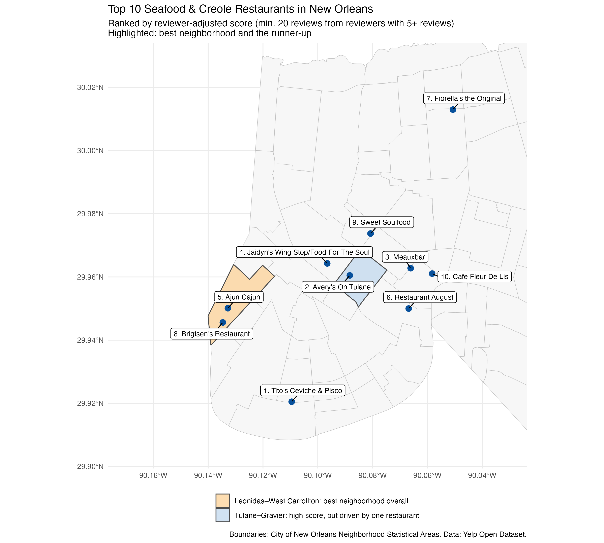
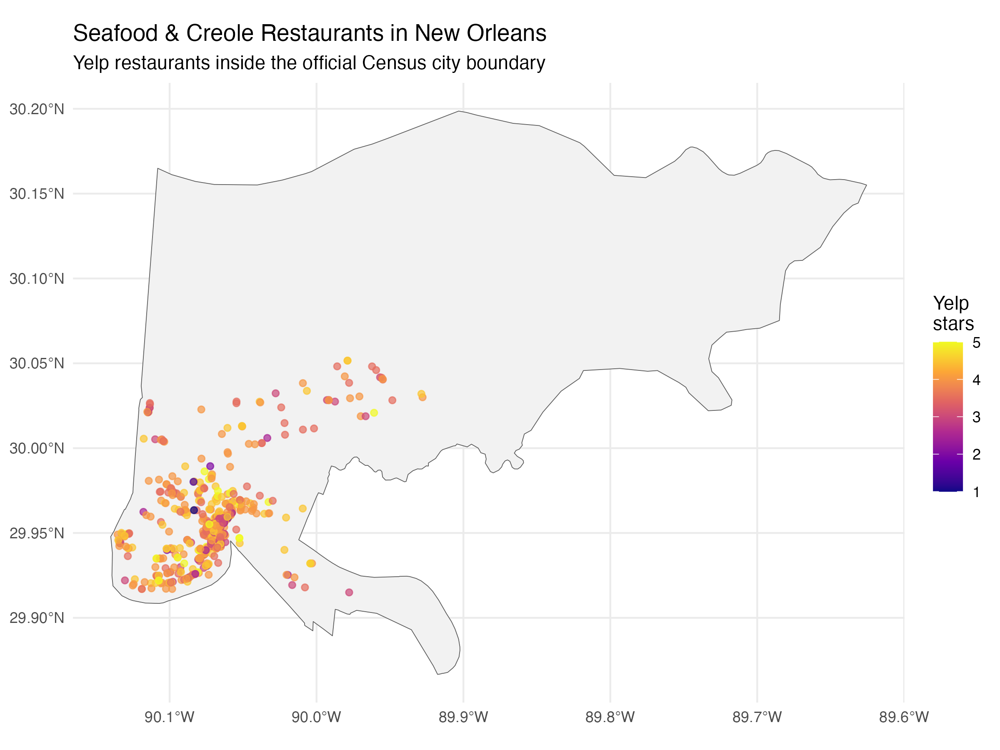
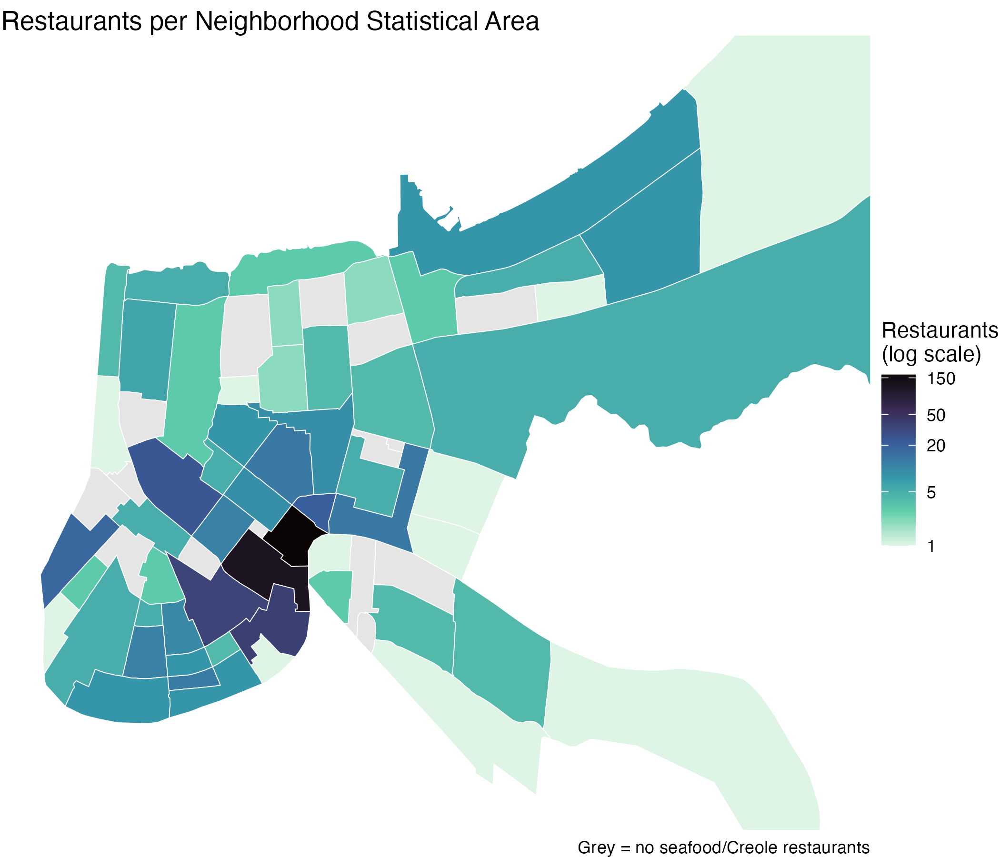
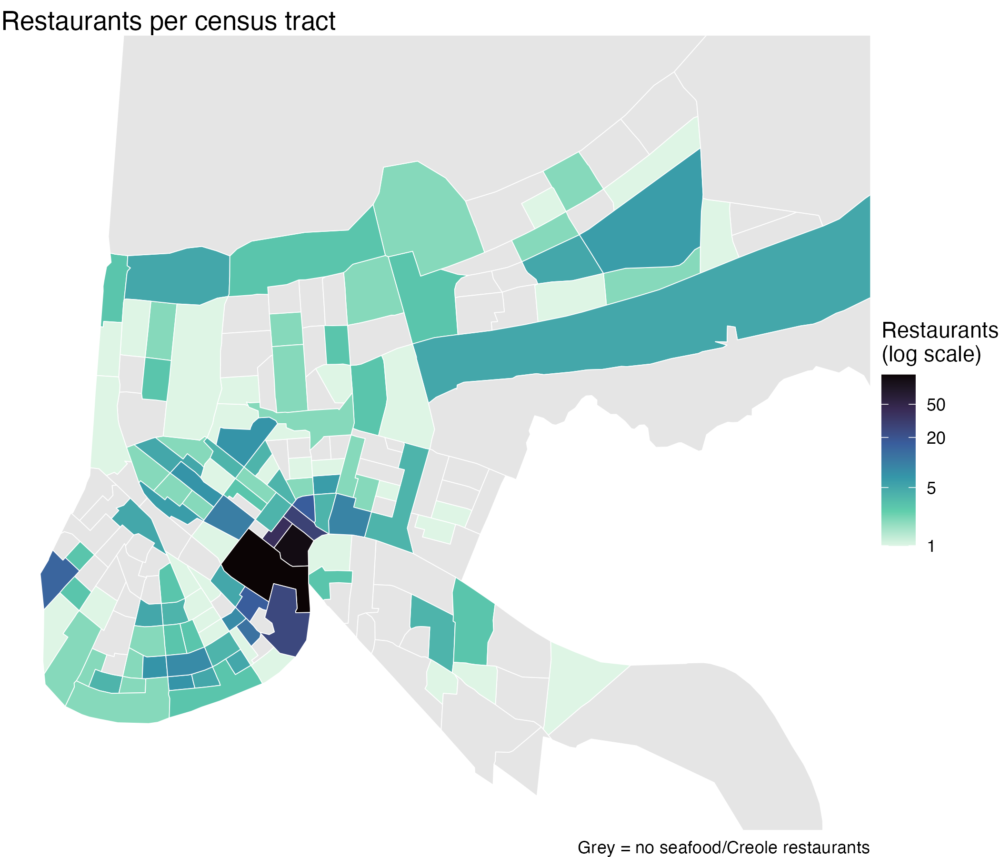
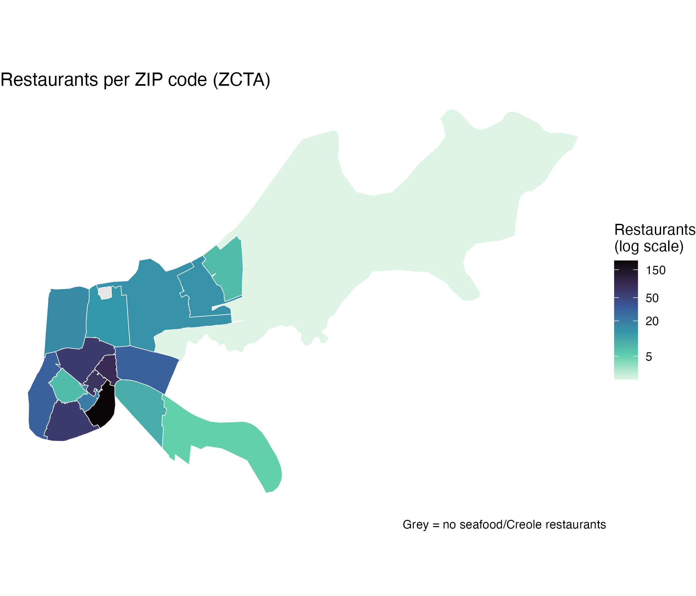
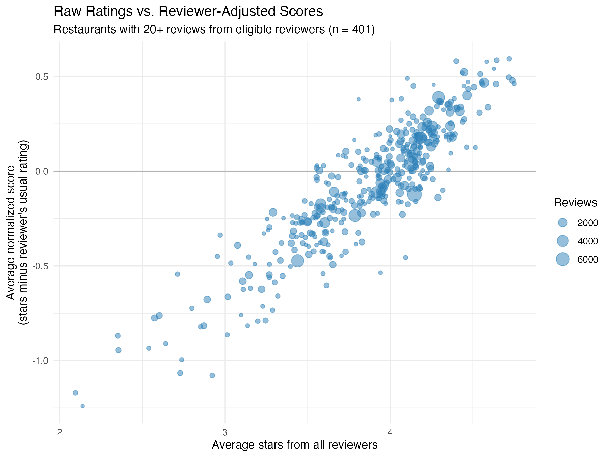

```{r}
#| label: setup
#| code-summary: "Packages and saved data"

library(tidyverse)
library(sf)
library(knitr)

# The report reads the small filtered files saved by the scripts in R/.
# The raw Yelp JSON files (5+ GB) are not needed to render this report.
selected_points    <- readRDS("data/new_orleans/selected_points.rds")
restaurant_summary <- readRDS("data/new_orleans/restaurant_summary.rds")
restaurant_areas   <- readRDS("data/new_orleans/restaurant_areas.rds")
nsa_ratings        <- readRDS("data/new_orleans/nsa_ratings.rds")
zcta_ratings       <- readRDS("data/new_orleans/zcta_ratings.rds")

min_eligible <- 20   # minimum reviews from eligible reviewers to rank a restaurant
```

## Research question

> **Where can someone find the best seafood, Cajun/Creole, Southern, and soul food restaurants in New Orleans, and which neighborhood is best for finding them?**

## Executive summary

I analyzed **658 seafood, Cajun/Creole, Southern, and soul food restaurants** inside the official New Orleans city boundary, using **249,146 Yelp reviews**. Ratings were adjusted for each reviewer's scoring habits, so a restaurant scores well only when experienced reviewers rate it **above their own usual rating**.

- **Best neighborhood: Leonidas–West Carrollton.** Experienced reviewers rate its restaurants about 0.2 stars above their norm. It has 12 well-reviewed restaurants and 2 of the top 10, ranked in the top two at every reviewer threshold I tested, and its score did not depend on any single restaurant.
- **The French Quarter has the most choice but the lowest hit rate.** It holds a quarter of the restaurants and about 98,000 reviews, but only about **1 in 3** of its well-reviewed restaurants beat their reviewers' usual rating, compared with **2 in 3** in Leonidas–West Carrollton.
- **The top 10 restaurants are spread across 8 neighborhoods.** The French Quarter and Leonidas–West Carrollton have 2 each, so great restaurants exist in the French Quarter, but they are harder to pick out from the many average ones.

## Answer: top 10 restaurants

```{r}
#| label: top10
#| code-summary: "Top 10 by reviewer-adjusted score"

top10 <- restaurant_summary |>
  filter(number_of_reviews_eligible_reviewers >= min_eligible) |>
  slice_max(average_normalized_score, n = 10) |>
  left_join(restaurant_areas, by = "business_id") |>
  mutate(rank = row_number(),
         neighborhood = str_to_title(nsa_name)) |>
  select(Rank = rank,
         Restaurant = business_name,
         Neighborhood = neighborhood,
         `All reviews` = number_of_reviews_all_reviewers,
         `Average stars (all reviewers)` = average_stars_all_reviewers,
         `Eligible reviews` = number_of_reviews_eligible_reviewers,
         `Adjusted score` = average_normalized_score)

kable(top10, digits = 2, format.args = list(big.mark = ","))
```

The **adjusted score** is the average of *(stars given − that reviewer's usual rating)* across reviewers with at least 5 reviews in this category group. A score of +0.59 means experienced reviewers rated the restaurant about six-tenths of a star above what they normally give. Only restaurants with at least 20 such reviews are ranked.



---

## 1. Data and large-data management

### Data sources

| File | Contents | Size |
|---|---|---:|
| `yelp_academic_dataset_business.json` | 150,346 businesses: name, location, categories, stars | 119 MB |
| `yelp_academic_dataset_review.json` | 6,990,280 reviews: stars, date, reviewer ID, business ID | 5,342 MB |

Both files come from the [Yelp Open Dataset](https://business.yelp.com/data/resources/open-dataset/). They are linked by `business_id` in a one-to-many relationship: one business has many reviews. Boundaries come from the U.S. Census (via `tigris`) and the [City of New Orleans GIS](https://gis.nola.gov/arcgis/rest/services/apps/BoundariesMayorysViewer/MapServer/3).

### Problems and solutions

I worked on a MacBook Pro with 24 GB of RAM and about 765 GB of free disk space. **Disk space was not the problem; memory was.** Loading the 5.3 GB review file whole, including all review text, would likely need 15–25 GB of RAM, enough to push the computer into heavy swapping or crash R.

| Problem | Solution |
|---|---|
| The review file is too large to load at once | Streamed it with `jsonlite::stream_in()` in **chunks of 50,000 lines** and kept only reviews for New Orleans restaurants before reading the next chunk |
| Each chunk carries unused columns | Kept only 9 columns (ID, business, user, stars, date, text, votes) |
| Filtered data still large because of review text | Saved a second copy **without the text**, since the analysis uses only stars, users, and dates |
| Raw JSON should not be on GitHub | `data/raw/` and the 82 MB text version are listed in `.gitignore`; only small compressed `.rds` files are committed |
| `stream_in()` returns a plain `data.frame` | Converted to a tibble with `as_tibble()` so `print(n = ...)` works |

The chunked import scanned all 6,990,280 reviews in **2.5 minutes**, with R's peak memory around **1.3 GB**. No sampling was used: the final results include **every** Yelp review for the selected restaurants.

| Stage | Size |
|---|---:|
| Raw review JSON (≈7 million reviews) | 5,342 MB |
| New Orleans restaurant reviews, with text (`.rds`, local only) | 82 MB |
| Same, without text (`.rds`, committed) | 16 MB |
| Raw business JSON | 119 MB |
| New Orleans restaurants (`.rds`, committed) | 0.12 MB |

```{r}
#| label: import-code
#| eval: false
#| code-summary: "Import code (R/import.R): not run when rendering"

library(tidyverse)
library(jsonlite)

business <- stream_in(file("data/raw/yelp_academic_dataset_business.json"), verbose = FALSE) |>
  as_tibble() |>
  select(business_id, name, address, city, state, postal_code,
         latitude, longitude, stars, review_count, categories)

new_orleans_restaurants <- business |>
  filter(state == "LA",
         str_to_lower(str_squish(city)) == "new orleans",
         !is.na(categories),
         str_detect(categories, regex("Restaurants", ignore_case = TRUE))) |>
  mutate(postal_code = na_if(postal_code, ""),
         categories = str_squish(categories),
         business_name = str_squish(name)) |>
  distinct(business_id, .keep_all = TRUE)

saveRDS(new_orleans_restaurants, "data/new_orleans/business_new_orleans.rds", compress = "xz")

# Stream the 5.3 GB review file in chunks, keeping only New Orleans restaurant reviews
nola_ids <- new_orleans_restaurants$business_id
review_chunks <- list()

stream_in(
  file("data/raw/yelp_academic_dataset_review.json"),
  handler = function(chunk) {
    keep <- chunk |>
      filter(business_id %in% nola_ids) |>
      select(review_id, business_id, user_id, stars, date, text, useful, funny, cool)
    review_chunks[[length(review_chunks) + 1]] <<- keep
  },
  pagesize = 50000
)

new_orleans_reviews <- bind_rows(review_chunks) |> as_tibble()

saveRDS(new_orleans_reviews |> select(-text),
        "data/new_orleans/reviews_new_orleans_notext.rds", compress = "xz")
```

### Defining a "New Orleans restaurant"

A business counts as a New Orleans restaurant if `state == "LA"`, its city label is "New Orleans" **in any capitalization**, and its categories contain "Restaurants." Exact matching on `city == "New Orleans"` would have missed variants such as `NEW ORLEANS` and `new orleans`. Suburbs such as Metairie and Kenner were excluded because the question is about the city itself.

This gives **2,261 restaurants** (out of 6,215 New Orleans businesses), with 0 missing coordinates and 1 missing postal code. The review file contains **476,565 reviews** for them, with no duplicate review IDs, dated March 2005 to January 2022. That is about 2% more than the sum of Yelp's own `review_count` field (466,124), likely because the two were recorded at different times, so all review counts in this report are computed from the review table.

## 2. Selecting restaurant categories

```{r}
#| label: categories
#| code-summary: "Split categories and count co-occurrence (R/categories.R)"

new_orleans_restaurants <- readRDS("data/new_orleans/business_new_orleans.rds")

restaurant_categories <- new_orleans_restaurants |>
  select(business_id, categories) |>
  separate_longer_delim(categories, delim = ",") |>
  mutate(category = str_to_lower(str_squish(categories))) |>
  select(-categories) |>
  filter(!category %in% c("restaurants", "food")) |>
  distinct()

category_counts <- restaurant_categories |>
  count(category, name = "restaurants", sort = TRUE)

category_pairs <- restaurant_categories |>
  inner_join(restaurant_categories, by = "business_id", relationship = "many-to-many") |>
  filter(category.x < category.y) |>
  count(category.x, category.y, name = "restaurants_with_both", sort = TRUE)

selected_categories <- c("seafood", "cajun/creole", "southern", "soul food")
```

Yelp gives each business several comma-separated categories. After splitting them into one row per business–category pair, I chose four related categories: **seafood, cajun/creole, southern, and soul food**. Together they describe one Gulf Coast and Southern food tradition.

```{r}
#| label: category-tables
#| layout-ncol: 2
#| code-summary: "Category tables"

category_counts |>
  slice_head(n = 15) |>
  mutate(selected = if_else(category %in% selected_categories, "Yes", "")) |>
  kable(caption = "15 most common categories (New Orleans restaurants)",
        col.names = c("Category", "Restaurants", "Selected"))

category_pairs |>
  filter(category.x %in% selected_categories, category.y %in% selected_categories) |>
  kable(caption = "Co-occurrence within the selected group",
        col.names = c("Category", "Category", "Restaurants with both"))
```

**Why these four belong together:** all six possible pairs occur. Cajun/creole is the hub: it is seafood's most common partner category (156 restaurants), and seafood is its most common partner. Southern also appears among the top partners of both. Nightlife and bars co-occur often too, but they describe the *type of venue*, not the food, so I left them out. I did not simply pick the most common categories, since nightlife and bars top the list.

**Inclusion rule:** a restaurant qualifies if it has **at least one** of the four categories. That gives **674 restaurants** with **250,448 reviews**. These restaurants are 30% of New Orleans restaurants but receive 53% of all New Orleans restaurant reviews.

## 3. Official city boundary (spatial join)

I converted each restaurant's latitude and longitude to an `sf` point and joined it to the 2024 Census place boundaries with `st_within`. The Census boundaries use NAD83 (EPSG 4269) and the Yelp points use WGS84 (EPSG 4326), so I transformed the boundaries with `st_transform(4326)` before joining.

```{r}
#| label: place-join-code
#| eval: false
#| code-summary: "Spatial join code (R/geography.R): needs internet to download boundaries"

louisiana_places <- tigris::places(state = "LA", cb = TRUE, year = 2024, class = "sf") |>
  st_transform(4326)

restaurant_points <- new_orleans_restaurants |>
  st_as_sf(coords = c("longitude", "latitude"), crs = 4326, remove = FALSE)

restaurants_with_place <- restaurant_points |>
  st_join(louisiana_places |> select(GEOID, place_name = NAME),
          join = st_within, left = TRUE)
```

| Yelp label vs. official place | Restaurants |
|---|---:|
| Inside the official New Orleans boundary | 2,204 (97.5%) |
| Labeled "New Orleans" but inside another place | 57 (2.5%) |

The 57 mismatches are not coordinate errors. Most are in Jefferson Parish suburbs, such as Elmwood (ZIP 70121/70123), Jefferson, and Harahan, where the Postal Service uses "New Orleans" as the mailing city. Since the question is about restaurants *in* New Orleans, I kept only restaurants inside the official boundary: **658 of the 674** selected restaurants.



## 4. Choosing a geographic system

I compared three systems using the same spatial-join function: Census **ZIP Code Tabulation Areas**, Census **tracts**, and the City of New Orleans' **Neighborhood Statistical Areas (NSAs)**.

```{r}
#| label: geography-table
#| code-summary: "Comparison table (from R/geography.R)"

read_csv("figures/geography_comparison.csv", show_col_types = FALSE) |>
  select(-extra_matches) |>
  kable(col.names = c("Geographic system", "Areas in city", "Areas with restaurants",
                      "Restaurants assigned", "Unmatched", "Smallest count",
                      "Largest count", "Median per area", "Areas with 5+"))
```

Every restaurant matched exactly one area in all three systems.

::: {.panel-tabset}
## Neighborhood Statistical Area



## Census tract



## ZIP code (ZCTA)


:::

**I chose Neighborhood Statistical Areas** for the main analysis:

- **They match the question.** A visitor thinks in neighborhoods, like the French Quarter, Marigny, or Bywater, not ZIP codes or tract numbers. NSAs are the City's official neighborhood boundaries, with documented names.
- **They give enough restaurants to compare.** NSAs have the most areas with at least 5 restaurants (30), and the group easily passes the requirement of 10+ restaurants in 7+ areas: 658 restaurants in 56 neighborhoods.
- **Census tracts are too small.** 73 of 184 tracts have none of these restaurants, and the median tract has only 2.
- **ZIP codes are too coarse.** They are stable, but one ZIP holds 214 restaurants, about a third of the data, and ZIP codes are postal areas, not neighborhoods. I kept ZIP codes as a **robustness check**.

**What NSAs hide:** variation inside large neighborhoods. The French Quarter alone holds 164 restaurants. Many NSAs also have only 1–4 restaurants, so I rank only neighborhoods with at least 5 restaurants.

## 5. Reviewer-adjusted ratings

### All reviewers vs. selected reviewers

```{r}
#| label: reviewer-setup
#| code-summary: "Reviewer activity and baselines (R/ratings.R)"

category_reviews <- readRDS("data/new_orleans/category_reviews.rds") |>
  semi_join(st_drop_geometry(selected_points), by = "business_id")

reviewer_activity <- category_reviews |>
  count(user_id, name = "reviews_in_group")

threshold_table <- tibble(threshold = c(1, 2, 3, 5, 10, 20)) |>
  mutate(
    reviewers_kept = map_int(threshold, ~ sum(reviewer_activity$reviews_in_group >= .x)),
    pct_reviewers  = reviewers_kept / nrow(reviewer_activity) * 100,
    reviews_kept   = map_int(threshold, ~ sum(reviewer_activity$reviews_in_group[
                                              reviewer_activity$reviews_in_group >= .x])),
    pct_reviews    = reviews_kept / nrow(category_reviews) * 100
  )

reviewer_baselines <- category_reviews |>
  group_by(user_id) |>
  summarise(reviewer_mean = mean(stars), reviewer_median = median(stars), .groups = "drop")

eligible_adjusted <- category_reviews |>
  semi_join(reviewer_activity |> filter(reviews_in_group >= 5), by = "user_id") |>
  left_join(reviewer_baselines, by = "user_id") |>
  mutate(normalized_mean_score   = stars - reviewer_mean,
         normalized_median_score = stars - reviewer_median)

kable(threshold_table, digits = 1, format.args = list(big.mark = ","),
      col.names = c("Minimum reviews per reviewer", "Reviewers kept", "% of reviewers",
                    "Reviews kept", "% of reviews"))
```

The 658 restaurants received `r format(nrow(category_reviews), big.mark = ",")` reviews from `r format(nrow(reviewer_activity), big.mark = ",")` reviewers. **About two-thirds of reviewers wrote only one review** in this group. For them, the "usual rating" is that single rating, so their adjusted score is always 0. They carry no information about how generous a reviewer is.

I used a threshold of **5 reviews**. That keeps 5% of reviewers but nearly a quarter of the reviews (about 60,000), because active reviewers write many reviews each. A baseline from 5 or more ratings is a reasonable estimate of someone's habits. Thresholds of 3 and 10 are tested below.

### Mean or median baseline?

```{r}
#| label: mean-vs-median
#| code-summary: "Compare mean- and median-based scores"

tibble(
  Baseline = c("Reviewer mean", "Reviewer median"),
  `Share of scores exactly 0` = c(mean(eligible_adjusted$normalized_mean_score == 0),
                                  mean(eligible_adjusted$normalized_median_score == 0))
) |>
  kable(digits = 3)
```

I used the **reviewer mean** as the baseline. Yelp stars are whole numbers, so a reviewer's median is usually a whole number too, and about half of median-based scores are exactly 0. The mean keeps much more information. The average eligible reviewer gives `r round(mean(eligible_adjusted$reviewer_mean), 2)` stars, but individual baselines range from 1.0 to 5.0, which is exactly the variation this adjustment corrects for. As a check, the mean adjusted score across all eligible reviews is `r format(round(mean(eligible_adjusted$normalized_mean_score), 6), scientific = FALSE)`, essentially 0 by construction.

The adjusted score is **not** a new Yelp rating. It measures whether reviewers rated a restaurant higher or lower than they usually rate.

### Why a minimum number of reviews per restaurant

```{r}
#| label: raw-top
#| code-summary: "Top restaurants by raw stars (all reviewers)"

restaurant_summary |>
  slice_max(average_stars_all_reviewers, n = 6, with_ties = FALSE) |>
  select(Restaurant = business_name, Reviews = number_of_reviews_all_reviewers,
         `Average stars` = average_stars_all_reviewers) |>
  kable(digits = 2, caption = "Highest raw averages: several rest on only 5 or 6 reviews")
```

Ranked by raw stars, the top of the list is dominated by restaurants with only 5–6 reviews. With a minimum of 5 *eligible* reviews (564 restaurants qualify), the adjusted top 10 still rested on 6–16 eligible reviews each. Requiring **20 eligible reviews** keeps 401 of 658 restaurants, and every top-10 restaurant is supported by 20 to 403 eligible reviews.

### Raw vs. adjusted rankings



```{r}
#| label: movers
#| code-summary: "Biggest rank changes after adjustment"

ranked <- restaurant_summary |>
  filter(number_of_reviews_eligible_reviewers >= min_eligible) |>
  mutate(rank_raw      = min_rank(desc(average_stars_all_reviewers)),
         rank_adjusted = min_rank(desc(average_normalized_score)),
         rank_change   = rank_raw - rank_adjusted)

movers <- bind_rows(
  ranked |> slice_max(rank_change, n = 5) |> mutate(direction = "Moved up"),
  ranked |> slice_min(rank_change, n = 5) |> mutate(direction = "Moved down")
)

movers |>
  select(Direction = direction, Restaurant = business_name,
         `Raw stars` = average_stars_all_reviewers, `Adjusted score` = average_normalized_score,
         `Raw rank` = rank_raw, `Adjusted rank` = rank_adjusted, Change = rank_change) |>
  kable(digits = 2)
```

The two methods broadly agree (correlation `r round(cor(ranked$average_stars_all_reviewers, ranked$average_normalized_score), 2)`), but rankings in the crowded middle shift a lot, because many restaurants sit between 3.6 and 4.3 stars.

- **Restaurants that moved up**, such as Le Citron Bistro (#249 to #27), have modest raw averages, but experienced reviewers rated them well above their own norm.
- **Restaurants that moved down**, such as Today's Cajun Seafood and Marjie's Grill, have high raw averages, but experienced reviewers rated them *below* their norm. Their raw averages are likely lifted by enthusiastic one-time reviewers.

Every ranked restaurant has at least 20 eligible reviews, so these changes reflect **who the reviewers are**, not tiny samples.

### Neighborhood results

```{r}
#| label: nsa-ranking
#| code-summary: "Neighborhood ranking (NSAs with 5+ rankable restaurants)"

nsa_best <- nsa_ratings |>
  filter(rankable_restaurants >= 5) |>
  arrange(desc(average_normalized_score)) |>
  mutate(Neighborhood = str_to_title(area),
         above_norm = round(rankable_restaurants * pct_above_norm / 100))

nsa_best |>
  select(Neighborhood,
         Restaurants = number_of_restaurants,
         `Rankable (20+ eligible)` = rankable_restaurants,
         `Above norm` = above_norm,
         `% above norm` = pct_above_norm,
         `Total reviews` = total_reviews,
         `Avg stars (all)` = average_stars_all_reviewers,
         `Adjusted score` = average_normalized_score,
         `Top-10 restaurants` = top10_restaurants) |>
  kable(digits = 2, format.args = list(big.mark = ","))
```

A neighborhood's **adjusted score** averages all eligible reviews in it. **% above norm** is the share of its rankable restaurants with a positive adjusted score, roughly your odds of picking a restaurant that experienced reviewers rate above their usual standard.

**Tulane–Gravier has the highest adjusted score, but it depends on one restaurant.** It has only 5 rankable restaurants, and Avery's On Tulane supplies about a third of its eligible reviews. I recomputed both top neighborhoods without their single best restaurant:

```{r}
#| label: leave-one-out
#| code-summary: "Leave-one-out check (R/ratings.R)"

read_csv("figures/leave_one_out.csv", show_col_types = FALSE) |>
  mutate(nsa_name = str_to_title(nsa_name)) |>
  kable(digits = 3, col.names = c("Neighborhood", "Adjusted score", "Without its best restaurant"))
```

Without Avery's, Tulane–Gravier falls below Leonidas–West Carrollton. Leonidas barely changes, because its strength is spread across many restaurants, including Jacques-Imo's, Dante's Kitchen, Boucherie, Brigtsen's, and DTB. **Leonidas–West Carrollton is therefore the best neighborhood for *finding* highly rated seafood and Creole food.**

### Robustness checks

**Reviewer threshold.** I re-ran the analysis with reviewer thresholds of 3, 5, and 10:

```{r}
#| label: sensitivity
#| code-summary: "Threshold sensitivity (R/ratings.R)"

read_csv("figures/threshold_sensitivity.csv", show_col_types = FALSE) |>
  kable(format.args = list(big.mark = ","),
        col.names = c("Reviewer threshold", "Reviewers", "Reviews", "Rankable restaurants",
                      "Top 10 same as main", "Best NSA", "Leonidas rank", "French Quarter rank"))
```

The **neighborhood ranking is stable**: Tulane–Gravier and Leonidas–West Carrollton are the top two at every threshold, and the French Quarter stays near the bottom (13th–15th of 17). The **restaurant top 10 is less stable**: only 4–5 of the 10 remain when the threshold changes. The top 10 is best read as a set of strong candidates, not an exact order.

**Geographic system.** The ZIP-code results agree with the NSA results. ZIP **70118**, which contains Leonidas–West Carrollton, ranks first on adjusted score, and the tourist-core ZIPs (70130, 70116, 70112) all score below zero.

```{r}
#| label: zcta-check
#| code-summary: "ZIP code (ZCTA) robustness check"

zcta_ratings |>
  arrange(desc(average_normalized_score)) |>
  select(ZIP = area, Restaurants = number_of_restaurants,
         `Avg stars (all)` = average_stars_all_reviewers,
         `Adjusted score` = average_normalized_score, `% above norm` = pct_above_norm) |>
  kable(digits = 2)
```

## 6. Conclusions

1. **Best neighborhood: Leonidas–West Carrollton.** It is near the top at every threshold, its score does not depend on any single restaurant, and the ZIP-code check confirms it.
2. **The French Quarter is where most of the choice is, not where the best odds are.** It has the most restaurants and reviews, and 2 of the top 10, but experienced reviewers rate its average restaurant slightly below their norm, and only about 1 in 3 of its well-reviewed restaurants beat that norm.
3. **Adjusting for reviewer habits matters for individual restaurants.** Some highly rated places drop sharply once one-time reviewers are set aside, and some modestly rated places rise.

## 7. Limitations

- **Yelp reviewers are not a random sample** of diners. Tourists are heavily represented in the French Quarter, and the dataset ends in January 2022.
- **The adjusted score uses only reviewers with 5 or more reviews in this group**, about 5% of reviewers. It describes experienced Yelp users, not all diners.
- **The restaurant ranking is sensitive to the reviewer threshold.** The neighborhood conclusion is not.
- **Category labels are self-reported** and inconsistent. Some restaurants tagged "seafood" or "southern" serve broader menus.
- **Neighborhood boundaries hide variation within large areas** such as the French Quarter.
- **Restaurants just outside the city line** (for example, in Metairie) were excluded by design.

## 8. Reproducibility and AI use

The analysis runs in four scripts, in order:

| Script | Steps |
|---|---|
| [`R/import.R`](https://github.com/vincentheqi/yelp-new-orleans-project/blob/main/R/import.R) | Stream the raw JSON, filter to New Orleans restaurants, save `.rds` |
| [`R/categories.R`](https://github.com/vincentheqi/yelp-new-orleans-project/blob/main/R/categories.R) | Category counts, co-occurrence, inclusion rule, review join |
| [`R/geography.R`](https://github.com/vincentheqi/yelp-new-orleans-project/blob/main/R/geography.R) | City-boundary join, ZCTA/tract/NSA comparison, maps |
| [`R/ratings.R`](https://github.com/vincentheqi/yelp-new-orleans-project/blob/main/R/ratings.R) | Reviewer adjustment, rankings, robustness checks, final map |

This report reads only the small `.rds` and figure files saved by those scripts, so it renders without the raw Yelp files. Rendered with:

```bash
quarto render yelp_new_orleans_project.qmd --output-dir docs
```

AI prompts, including examples of where I re-prompted or corrected the AI's code, are documented in the [AI prompt log](https://github.com/vincentheqi/yelp-new-orleans-project/blob/main/ai-log.md).
